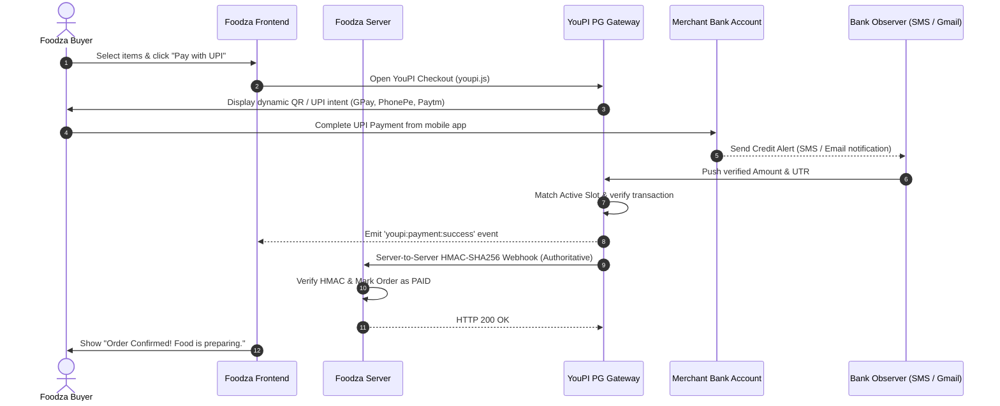

f# 🍕 Foodza — YouPI PG Payment Integration Guide

Comprehensive, step-by-step guide to integrating **YouPI PG** into **Foodza** for zero-aggregator-fee UPI payments with instant direct-to-bank settlement.

---

## Table of Contents
1. [Architecture & Payment Flow](#1-architecture--payment-flow)
2. [Prerequisites & Configuration](#2-prerequisites--configuration)
3. [Frontend Integration](#3-frontend-integration)
   - [Option A: HTML / Blade / EJS (Declarative Button)](#option-a-html--blade--ejs-declarative-button)
   - [Option B: React / Next.js (Programmatic SDK)](#option-b-react--nextjs-programmatic-sdk)
4. [Backend Integration & Webhook Security](#4-backend-integration--webhook-security)
   - [Node.js / Express](#nodejs--express)
   - [Next.js App Router (Route Handlers)](#nextjs-app-router-route-handlers)
   - [Python (FastAPI / Flask)](#python-fastapi--flask)
   - [PHP / Laravel](#php--laravel)
5. [Configuring Merchant Admin for Foodza](#5-configuring-merchant-admin-for-foodza)
6. [Testing the End-to-End Flow](#6-testing-the-end-to-end-flow)
7. [Production Deployment Checklist](#7-production-deployment-checklist)

---

## 1. Architecture & Payment Flow



---

## 2. Prerequisites & Configuration

### Local Service Ports & Endpoints
| Component | Local URL | Purpose |
|---|---|---|
| **Checkout Portal** | `http://127.0.0.1:7000` | Embeddable payment modal and `youpi.js` SDK |
| **Payment REST API** | `http://127.0.0.1:6100` | Gateway order creation & status API |
| **Merchant Admin** | `http://127.0.0.1:6001` | VPA setup, branding & webhook config |
| **Control Center** | `http://127.0.0.1:8090` | Service supervisor & live logs |

> **Note on macOS**: Always use `http://127.0.0.1` rather than `http://localhost` for ports `5000` and `7000` to avoid conflicts with macOS AirPlay Receiver.

---

## 3. Frontend Integration

### Step 1: Load the YouPI Integration Script

Add the script tag inside Foodza's `<head>` (or root layout):

```html
<script 
  src="http://127.0.0.1:7000/youpi.js" 
  data-youpi-key="00000000-0000-0000-0000-000000000001" 
  data-currency="INR">
</script>
```
*(In production, replace `http://127.0.0.1:7000` with your public checkout domain, e.g. `https://pay.foodza.com`).*

---

### Option A: HTML / Blade / EJS (Declarative Button)

If Foodza uses standard HTML or server templates (Blade, EJS, Django):

```html
<button 
  type="button"
  data-youpi-pay
  data-order-id="FDZ-ORDER-1001"
  data-amount="349.00"
  data-name="Foodza"
  data-description="1x Butter Chicken + 2x Garlic Naan"
  data-customer-name="Kushal"
  data-customer-phone="9876543210"
  data-success-url="/order-success?order_id=FDZ-ORDER-1001"
  data-failed-url="/order-failed?order_id=FDZ-ORDER-1001"
  class="btn-foodza-checkout">
  🍕 Place Order · Pay ₹349.00
</button>
```

When clicked, the script automatically:
1. Intercepts the click.
2. Dims and blurs Foodza's background.
3. Renders the centered 2-column modal (or fluid bottom sheet on mobile).
4. Loads the WhatsApp pre-checkout verification (if enabled) and dynamic UPI QR code.

---

### Option B: React / Next.js (Programmatic SDK)

For modern SPAs or Next.js applications:

```tsx
// components/CheckoutButton.tsx
'use client';

import React from 'react';

interface CartProps {
  orderId: string;
  totalAmount: number;
  customerName: string;
  customerPhone: string;
}

declare global {
  interface Window {
    Youpi?: {
      pay: (options: any) => void;
    };
  }
}

export function FoodzaCheckoutButton({ orderId, totalAmount, customerName, customerPhone }: CartProps) {
  const handlePayment = () => {
    if (!window.Youpi) {
      alert('Payment SDK loading... Please try again in a moment.');
      return;
    }

    window.Youpi.pay({
      order_id: orderId,
      amount: totalAmount,
      currency: 'INR',
      name: 'Foodza',
      description: `Foodza Delivery Order #${orderId}`,
      customer: {
        name: customerName,
        phone: customerPhone
      },
      // Callback executed when the payment is verified
      handler: function (response: { status: string; order_id: string; amount_received: number; utr: string }) {
        console.log('[Foodza] Payment Verified:', response);
        window.location.href = `/orders/confirmation?order_id=${response.order_id}&utr=${response.utr}`;
      },
      onFailed: function (err: { reason: string }) {
        alert('Payment verification timed out or declined: ' + err.reason);
      },
      onClose: function () {
        console.log('Customer closed payment modal');
      }
    });
  };

  return (
    <button onClick={handlePayment} className="bg-red-500 hover:bg-red-600 text-white font-bold py-3 px-6 rounded-xl shadow-lg">
      Pay ₹{totalAmount.toFixed(2)} with UPI
    </button>
  );
}
```

---

## 4. Backend Integration & Webhook Security

> ⚠️ **CRITICAL SECURITY REQUIREMENT**:  
> Frontend browser events can be spoofed. **Never mark food orders as confirmed or initiate kitchen preparation based solely on browser callbacks.** Only fulfill orders when you receive an **HMAC-SHA256 verified webhook** on your backend.

### Webhook Specification
- **Method**: `POST`
- **Header**: `X-Gateway-Signature: sha256=<64_hex_hash>`
- **Header**: `X-Gateway-Event: SUCCESS`
- **Verification Rule**: Compute HMAC-SHA256 of the **raw, unparsed request body** using your `YOUPI_WEBHOOK_SECRET` and compare in constant time.

---

### Node.js / Express

```javascript
// server/routes/webhook.js
import express from 'express';
import crypto from 'node:crypto';

const router = express.Router();

// IMPORTANT: Use express.raw so body is an unmodified Buffer
router.post('/api/youpi-webhook', express.raw({ type: 'application/json' }), async (req, res) => {
  const signature = req.headers['x-gateway-signature'] || '';
  const secret = process.env.YOUPI_WEBHOOK_SECRET || 'your_foodza_webhook_secret';

  // 1. Calculate expected HMAC-SHA256
  const expected = 'sha256=' + crypto
    .createHmac('sha256', secret)
    .update(req.body)
    .digest('hex');

  // 2. Constant-time comparison to prevent timing attacks
  if (
    signature.length !== expected.length ||
    !crypto.timingSafeEqual(Buffer.from(signature), Buffer.from(expected))
  ) {
    console.error('[Foodza Webhook] Invalid signature rejected');
    return res.status(401).json({ error: 'Invalid webhook signature' });
  }

  // 3. Parse JSON payload
  const payload = JSON.parse(req.body.toString('utf8'));

  if (payload.event === 'SUCCESS') {
    const { orderId, amount, utr, paymentId } = payload;
    console.log(`[Foodza Webhook] ✅ Order ${orderId} PAID ₹${amount}. Bank UTR: ${utr}`);

    // Update your database: Mark order as ACCEPTED & SEND TO KITCHEN
    // await db.orders.update({ where: { id: orderId }, data: { status: 'PREPARING', utr, paymentId } });
  }

  return res.status(200).json({ received: true });
});

export default router;
```

---

### Next.js App Router (Route Handlers)

```typescript
// app/api/youpi-webhook/route.ts
import { NextRequest, NextResponse } from 'next/server';
import crypto from 'node:crypto';

export async function POST(req: NextRequest) {
  try {
    const rawBody = await req.text();
    const signature = req.headers.get('x-gateway-signature') || '';
    const secret = process.env.YOUPI_WEBHOOK_SECRET || 'your_foodza_webhook_secret';

    const expected = 'sha256=' + crypto
      .createHmac('sha256', secret)
      .update(Buffer.from(rawBody, 'utf8'))
      .digest('hex');

    if (
      signature.length !== expected.length ||
      !crypto.timingSafeEqual(Buffer.from(signature), Buffer.from(expected))
    ) {
      return NextResponse.json({ error: 'Invalid signature' }, { status: 401 });
    }

    const payload = JSON.parse(rawBody);

    if (payload.event === 'SUCCESS') {
      const { orderId, amount, utr } = payload;
      console.log(`[Foodza] Order ${orderId} verified. Paid: ₹${amount}, UTR: ${utr}`);
      // Fulfill order in database
    }

    return NextResponse.json({ received: true });
  } catch (err: any) {
    return NextResponse.json({ error: err.message }, { status: 500 });
  }
}
```

---

### Python (FastAPI / Flask)

#### FastAPI:
```python
import hmac
import hashlib
import json
from fastapi import FastAPI, Request, HTTPException

app = FastAPI()
WEBHOOK_SECRET = "your_foodza_webhook_secret".encode("utf-8")

@app.post("/api/youpi-webhook")
async def youpi_webhook(request: Request):
    raw_body = await request.body()
    signature = request.headers.get("X-Gateway-Signature", "")

    expected = "sha256=" + hmac.new(WEBHOOK_SECRET, raw_body, hashlib.sha256).hexdigest()
    if not hmac.compare_digest(signature, expected):
        raise HTTPException(status_code=401, detail="Invalid signature")

    payload = json.loads(raw_body.decode("utf-8"))
    if payload.get("event") == "SUCCESS":
        order_id = payload["orderId"]
        utr = payload["utr"]
        amount = payload["amount"]
        print(f"[Foodza] Order {order_id} marked as PAID. UTR: {utr}, Amount: {amount}")
        # update_foodza_order_status(order_id, "PREPARING")

    return {"received": True}
```

---

### PHP / Laravel

```php
<?php
// routes/api.php or public/youpi-webhook.php

$rawPayload = file_get_contents('php://input');
$signature = $_SERVER['HTTP_X_GATEWAY_SIGNATURE'] ?? '';
$secret = getenv('YOUPI_WEBHOOK_SECRET') ?: 'your_foodza_webhook_secret';

$expected = 'sha256=' . hash_hmac('sha256', $rawPayload, $secret);

if (!hash_equals($expected, $signature)) {
    http_response_code(401);
    exit(json_encode(['error' => 'Invalid signature']));
}

$payload = json_decode($rawPayload, true);

if (($payload['event'] ?? '') === 'SUCCESS') {
    $orderId = $payload['orderId'];
    $utr = $payload['utr'];
    $amount = $payload['amount'];
    // Update Foodza order: Order::where('id', $orderId)->update(['status' => 'PREPARING', 'utr' => $utr]);
}

http_response_code(200);
echo json_encode(['received' => true]);
```

---

## 5. Configuring Merchant Admin for Foodza

1. Open the **Merchant Admin Dashboard**: [http://127.0.0.1:6001](http://127.0.0.1:6001)
2. Enter the **Admin Token**:
   ```text
   d20cfda3e3d9a6e151bfd3f07440f634d6361c0b92278be76e7c61c3d972df32
   ```
   *(Stored in `data/.secrets/admin_api_token`)*
3. **Configure Receiving VPA**:
   - Go to **Receiving Accounts**.
   - Add your business/personal UPI ID (e.g. `foodza@upi` or `9876543210@paytm`).
4. **Set Webhook Endpoint**:
   - Go to **Webhooks**.
   - Set URL: `http://localhost:3000/api/youpi-webhook` (or Foodza's backend URL).
   - Copy the generated `Webhook Secret` and set it as `YOUPI_WEBHOOK_SECRET` in Foodza's `.env`.
5. **Brand Customization**:
   - Set **App Name**: `Foodza`
   - Set **Primary Color**: `#E11D48` (Foodza Red) or your brand color.
   - Set **Logo URL**: Foodza's logo image URL.

---

## 6. Testing the End-to-End Flow

1. **Verify YouPI PG is running**:
   - Open [http://127.0.0.1:8090](http://127.0.0.1:8090) (Control Center) to confirm all services are green.
2. **Launch Foodza with the button**:
   - Open Foodza in your browser.
   - Add an item to the cart and click the checkout button.
   - The YouPI checkout modal will appear with the dynamic QR code.
3. **Simulate / Verify Payment**:
   - In test mode, scan the QR with any UPI app for a ₹1.00 test payment.
   - When the bank SMS / Gmail alert arrives, the gateway observers capture the UTR.
   - The modal updates to "Payment Confirmed".
   - Your Foodza backend receives the HMAC-verified webhook and marks the order as paid.

---

## 7. Production Deployment Checklist

- [ ] **Domain Mapping**: Use Cloudflare Tunnels or Nginx to point `pay.foodza.com` to port `7000` and `api.foodza.com` to port `6100`.
- [ ] **Cryptographic Secrets**: Rotate `ENCRYPTION_MASTER_KEY` and `JWT_SECRET` in `.env` with fresh 32-byte random hex keys (`crypto.randomBytes(32).toString('hex')`).
- [ ] **Android Observer App**: Install `android-observer-app` APK on the merchant device with the SIM card receiving bank alerts.
- [ ] **Gmail Observer**: Configure OAuth credentials (`GMAIL_CLIENT_ID`, `GMAIL_CLIENT_SECRET`) to read bank credit alert emails as a backup channel.
- [ ] **CSP Allowlist**: Add Foodza's origin to `CHECKOUT_FRAME_ANCESTORS` in `.env` (e.g. `https://foodza.com`).
